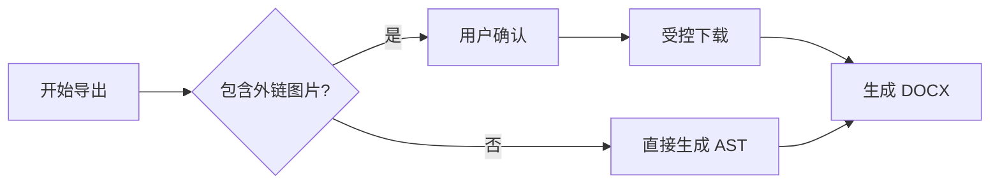
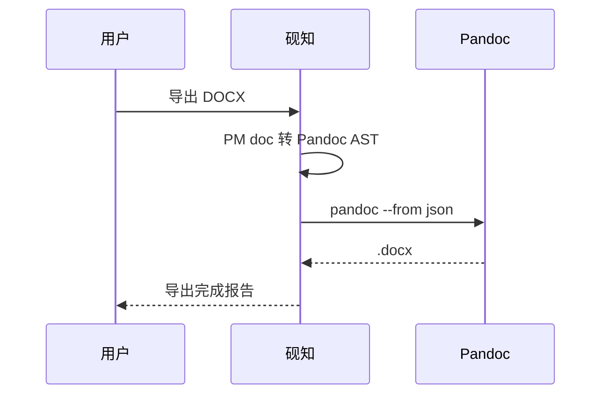

# DOCX 导出测试文档

> [!INFO] 使用方式
> 这份文档本身就是要导出的测试样本。先按「测试准备」补齐本机资源，再从 **文件 → 导出 Word (.docx)…** 或右键菜单导出，最后逐项核对「验收清单」。

## 1. 测试准备

1. 安装并配置 Pandoc 3+：
   - 设置 → 导出 → Pandoc 路径；
   - 状态应显示类似 `pandoc 3.x`。
2. 在同一知识库创建一篇文档，标题命名为：
   - `DOCX 导出测试目标`
3. 右侧标签面板为本文添加标签：
   - `DOCX`
   - `导出测试`
   - `验收`
4. 本文包含一个本地图片占位符。用 `/图片` 插入一张真实图片替换它，并在图片工具条中：
   - 选择 `50%` 宽度；
   - 选择居中。
5. 本文包含一个本地附件占位符。用 `/附件` 插入一个真实文件替换它。
6. 外链图片有三张：
   - GitHub PNG：应能下载嵌入；
   - example.com 404：应降级为链接；
   - 192.168.1.1：应被内网地址防护拦截。
7. 若要测试自定义模板，先用 Pandoc 生成或准备一个 `.docx` reference doc，再到设置 → 导出 → Word 模板选择它。

## 2. 标题层级与基础排版

# 一级标题

## 二级标题

### 三级标题

#### 四级标题

##### 五级标题

###### 六级标题

普通段落：中英混排 with English text、中文标点，以及数字 1234567890。

**粗体**、*斜体*、~~删除线~~、`inline code`、==高亮==、<u>下划线</u>。

<font color="#e05c5c">红色</font>、<font color="#e6a23c">橙色</font>、<font color="#c9a018">黄色</font>、<font color="#4ea832">绿色</font>、<font color="#29a8ab">青色</font>、<font color="#3b82f6">蓝色</font>、<font color="#8e5cd9">紫色</font>、<font color="#8f959e">灰色</font>。

<font color="#123456">任意色值</font> 与 <font color="not-a-color">非法色值</font>。

外部链接：[带题注链接](https://pandoc.org "Pandoc 官网")；普通链接：[Pandoc Manual](https://pandoc.org/MANUAL.html)。

可解析双链：[[DOCX 导出测试目标]]。

失效双链：[[肯定不存在的 DOCX 测试目标|失效双链]]。

硬换行测试：  
这是硬换行后的第二行。

---

## 3. 列表与任务状态

- 项目一
- 项目二
  - 嵌套项目 2.1
  - 嵌套项目 2.2
    - 深层项目 2.2.1

5. 有起始值的有序列表
6. 第二项
   1. 嵌套有序
   2. 嵌套有序第二项

- [ ] 未完成任务
- [x] 已完成任务【状态应显式保留】
  - [ ] 嵌套未完成任务
  - [x] 嵌套已完成任务

## 4. 引用与 Callout

> 普通引用：导出后应保持引用语义。

> [!INFO] 信息提示
> 信息正文，包含 **粗体** 与 `code`。

> [!SUCCESS] 成功提示
> 成功正文。

> [!WARNING] 警告提示
> 警告正文，包含公式 $a+b=c$。

> [!CAUTION] 注意提示
> 注意正文，包含下表：

| 类型 | 状态 |
| --- | --- |
| Callout | 应使用命名样式 |
| 表格 | 应保留 |

> [!INFO] 嵌套内容
> ```ts
> const nested = "callout code";
> ```

## 5. 表格对齐与列宽

| 左对齐 | 居中 | 右对齐 | 默认 |
| :-- | :--: | --: | --- |
| a | b | c | d |
| **粗体** | `code` | [链接](https://pandoc.org) | 普通 |
| 中文长文本，用来观察 Word 中单元格换行与列宽是否可读 | 第二列 | 第三列 | 第四列 |
| `SPECIAL_LABEL` | snake_case | *斜体* | ~~删除线~~ |

导出前可在编辑器中拖拽调整一次列宽；该宽度是会话级属性，导出应尽量保留。

## 6. 代码块与语法高亮

```ts
type DocxExport = {
  title: string;
  tags: string[];
};

export const sample: DocxExport = {
  title: "DOCX 语义导出",
  tags: ["DOCX", "导出测试"],
};

console.log(sample.title, sample.tags.length);
```

```python
def add(a: int, b: int) -> int:
    """测试 Python 注释与函数高亮。"""
    return a + b
```

```text
这是纯文本代码块。
No syntax highlighting is required.
```

```unknownlanguage
unknown language block
```

## 7. 数学公式

行内公式：$E=mc^2$、$\alpha_i^2 + \beta_i^2$、$\frac{a}{b}$。

$$
\int_0^1 x^2 \, dx = \frac{1}{3}
$$

多行公式：

$$
a^2 + b^2 = c^2 \\
\sin^2 x + \cos^2 x = 1
$$

矩阵与 aligned 环境：

$$
\begin{aligned}
x &= 1 + 2 \\
y &= x + 3
\end{aligned}
$$

$$
\begin{pmatrix}
a & b \\
c & d
\end{pmatrix}
$$

## 8. Mermaid 图表





<details>
<summary>预期错误：展开查看无效 Mermaid</summary>

下面的图故意写成非法语法，用于验证编辑器错误态与 DOCX 导出降级；默认收起，避免打开测试文档时直接出现红色错误提示。

```mermaid
this is intentional invalid mermaid syntax
```

</details>

## 9. 本地图片、外链图片与附件


[DOCX 本地附件占位符.pdf](./assets/docx-local-attachment.pdf)

## 10. 折叠块与 Raw HTML

<details>
<summary>默认收起的折叠块</summary>

折叠内容第一段。

- 折叠块内列表 A
- 折叠块内列表 B

</details>

<details open>
<summary>默认展开的折叠块</summary>

<font color="#3b82f6">折叠块中的蓝色文本。</font>

```ts
const inDetails = "details code";
```

</details>

<details>
<summary>特殊字符 &amp; &lt; 与 "引号"</summary>

特殊字符内容。

<details>
<summary>内层折叠保持源码</summary>

内层内容应作为 Raw HTML 保留。

</details>

</details>

<div class="yz-docx-raw-html-test">
  <strong>这块 HTML 应在砚知中安全预览，导出 DOCX 时保留源码。</strong>
  
</div>

## 11. 边界字符

- Unicode：CJK 中日韓、emoji ✅📌🧪、全角标点 ！？：；
- 引号：`"double"`、`'single'`、`backtick`
- Markdown 转义：\*not italic\*、\_SPECIAL\_LABEL\_、\[\[not wiki\]\]
- 长 URL：[Pandoc Manual](https://pandoc.org/chunkedhtml-demo/8.18-docx.html)

## 12. 导出模式检查

### 12.1 Pandoc 未安装或路径错误

1. 在设置 → 导出中把 Pandoc 路径改为不存在的路径。
2. 触发导出。
3. 预期：
   - 不出现保存对话框；
   - 提示未检测到 Pandoc；
   - 自动打开设置 → 导出。

### 12.2 外链图片：取消导出

1. 保持外链策略为「每次询问」。
2. 触发导出。
3. 在确认框点击「取消导出」。
4. 预期：
   - 不发起图片下载；
   - 不出现保存对话框；
   - 不生成 `.docx`。

### 12.3 外链图片：不请求

1. 触发导出。
2. 点击「不请求，导出链接」。
3. 预期：
   - 外链图片均导出为普通链接；
   - 报告中显示选择链接的数量；
   - 不发生导出图片下载请求。

### 12.4 外链图片：下载并嵌入

1. 触发导出。
2. 点击「下载并嵌入」。
3. 预期：
   - GitHub PNG 嵌入 `word/media/`；
   - example.com 404 降级为链接并显示 warning；
   - 192.168.1.1 被防护拦截并显示 warning；
   - 导出继续成功。

### 12.5 覆盖导出

1. 连续导出两次到同一个 `.docx` 文件。
2. 第二次保存对话框确认覆盖。
3. 预期：
   - 文件可打开；
   - 内容为最新导出结果；
   - 无残留 `.yanzhi-tmp` 文件。

### 12.6 中文与空格路径

1. 保存到包含中文和空格的目录，例如：
   - `~/Documents/DOCX 导出 测试/DOCX 导出测试文档.docx`
2. 预期：
   - 保存成功；
   - Word 可直接打开；
   - 本地图片和附件路径不因中文或空格失效。

### 12.7 单文件模式

1. 关闭知识库。
2. 用「打开 Markdown 文件」直接打开本文。
3. 导出 DOCX。
4. 预期：
   - 基础内容正常；
   - 本地资源按本文所在文件夹解析；
   - 双链没有知识库上下文，保留文本与目标并显示 warning；
   - 标签元数据不导出。

### 12.8 自定义 reference doc

1. 选择用户自定义 `.docx` reference doc。
2. 导出本文。
3. 预期：
   - 标题、正文、表格基础样式跟随自定义模板；
   - 砚知 Callout / Details / 代码高亮语义仍应存在或给出可读 warning。

## 13. 验收清单

| 场景 | 预期 |
| :-- | :-- |
| 标题 H1-H6 | 层级与顺序保留 |
| 粗体 / 斜体 / 删除线 / 下划线 | 样式保留 |
| ==高亮== | Word highlight 保留 |
| `<font color>` | 色值尽量保留；非法色降级正文色并 warning |
| 任务列表 | `☐ / ☒` 状态保留 |
| 表格 | 对齐保留，列宽尽量保留 |
| 行内 / 块级公式 | 转为 Word OMML |
| 多行公式 / matrix | 可读，不回退为源码 |
| Mermaid | 两个有效图渲染嵌入；一个无效图保留源码并 warning |
| Callout | 四种命名样式，标题和正文保留 |
| Details | summary 与正文保留；交互折叠降级 |
| Raw HTML | 保留源码，不静默丢失 |
| 本地图片 | 只解析 assets；替换后的真实图片嵌入 DOCX |
| 外链成功图片 | 受控下载后嵌入 DOCX |
| 外链 404 | 降级为链接并 warning |
| 内网图片 URL | 阻止请求并 warning |
| 附件 | 导出为本地链接 |
| 有效双链 | 导出到目标 Markdown 文件链接 |
| 失效双链 | 保留文本与目标并 warning |
| 标题插入 | 不额外在正文顶部插入文件名/标题；正文自己的 H1 保留 |
| 标签元数据 | 知识库模式下导出为 keywords |
| 保存路径 | 中文、空格路径可用 |
| 覆盖导出 | 可重复覆盖且无临时文件残留 |
| 导出 loading | 原生保存位置对话框期间不出现;点击 Save 后立即出现,且至少展示 300ms 后才提示成功/总结 |
| 无异常导出 | 直接显示成功提示,不弹总结弹框 |
| 有降级导出 | 显示当前总结弹框,列明降级与 warning |
| 导出报告 | 统计与 warning 可读、可关闭 |
